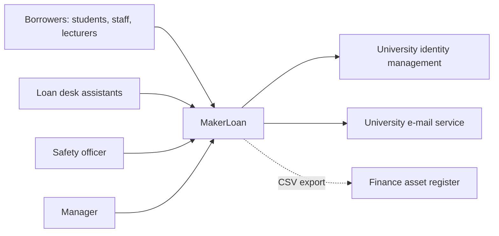
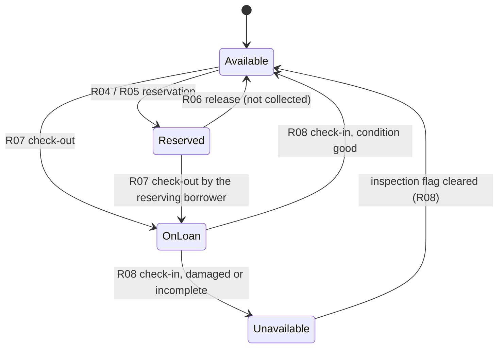

# Software Requirements Specification
## for MakerLoan — Equipment Loans for a University Makerspace

**Version 1.0 (Iteration 1 / Milestone 1)**
**Prepared by:** Youssef Mahmoud (13005321), Ahmed Mohamed (10004611), Saeed Mahmoud (10000885), Ahmed Walid (10003458), Jana Harfouche (10001636)
**Organization:** German International University — Faculty of Informatics and Computer Science, INCS508 Requirements Engineering, Winter 2026
**Date created:** 2026-11-26

> Structure follows the IEEE Std 830 based SRS template (Week 7). Requirements follow Principle-Driven Requirements Engineering (PDRE, Week 8): SOLID, KISS, DRY, YAGNI and the business-smell checks. The PDRE evidence is in Appendix D.

---

## Table of Contents

1. Introduction
2. Overall Description
3. External Interface Requirements
4. System Features (F1–F5, R01–R15)
5. Other Nonfunctional Requirements (incl. Business Rules BR-01…BR-07)
6. Other Requirements
7. Traceability (to case description and to prototype)
- Appendix A: Glossary
- Appendix B: Analysis Models
- Appendix C: To Be Determined List
- Appendix D: PDRE Compliance Check
- Appendix E: Case Description Reference Key

## Revision History

| Name | Date | Reason For Changes | Version |
|---|---|---|---|
| MakerLoan team | 2026-11-26 | First version for Milestone 1 (5 features, 15 requirements) | 1.0 |

---

## 1. Introduction

### 1.1 Purpose
This document specifies the software requirements of **MakerLoan**, release 1.0 (first version), a web system that manages equipment, reservations and loans for the makerspace of a mid-size university in Berlin. It covers the complete first version of the product, limited to the five features F1–F5 and the fifteen requirements R01–R15 defined in Section 4. A vibe-coded prototype (`M1/prototype/`) demonstrates these features and requirements.

### 1.2 Document Conventions
- **Features** are numbered **F1–F5**. **Requirements** are numbered **R01–R15**; each has a unique ID, exactly one feature, one type — **FR** (Functional), **NFR** (Non-functional) or **C** (Constraint) — and one priority.
- **Only R01–R15 are requirements.** Values that several requirements share (loan periods, time limits, thresholds) are kept once as **Business Rules BR-01…BR-07** in Section 5.5 and referenced by ID. This follows the PDRE rules DRY and Shotgun-Surgery avoidance: a change to a rule is one edit. Business rules are not counted as requirements, as the template states.
- "Shall" marks a mandatory requirement. Priorities use **High / Medium / Low** (template wording); a High requirement is needed for the first version to deliver value.
- Case-description elements are cited with the reference keys of Appendix E (e.g. PR2, BG1, DLO3). Prototype elements are cited by view name (Section 7.2).
- Requirement statements are written without universal qualifiers ("always", "never", "all") unless truly universal. Every statement contains one business need (PDRE: Single Responsibility, KISS).

### 1.3 Intended Audience and Reading Suggestions
| Reader | Read first |
|---|---|
| Client (Mr. Richter), Ms. Okafor, Mr. Becker, Prof. Hoffmann, Mr. Rossi | 1.4, 2.2, 2.3, Section 4, Appendix C (open questions) |
| Developers | Section 3, Section 4, Section 5 |
| Testers | Section 4 (fit criteria), Section 5.5 |
| Course instructor / TA | Section 7 (traceability), Appendix D |

### 1.4 Product Scope
MakerLoan replaces the paper slips and shared spreadsheet now used at the makerspace loan desk (PR0). It lets the makerspace know where each item is and who is responsible (BG1), lets borrowers check availability and reserve without visiting the desk (BG2), reduces overdue and lost equipment (BG3), and makes sure safety-relevant equipment is used only by people who are allowed to use it (BG4).

**In scope (Release 1.0):** equipment catalog, availability, reservations (including lecturer course reservations), check-out and check-in at the desk, safety-briefing records and their enforcement, overdue handling and manager reports.
**Out of scope:** purchasing new equipment; booking of rooms or machines that never leave the makerspace; repair management beyond recording an item's condition (OOS1–OOS3 of the case).
**Deferred (YAGNI, see Appendix C):** loan limits per borrower, blocking check-outs for borrowers with overdue loans, payment of fines, SMS or app notifications, a live interface to the finance asset register.

### 1.5 References
1. *Requirements Engineering – Case Study: MakerLoan*, German International University, INCS508, Winter 2026 (Case – MakerLoan.pdf).
2. *Milestone 1 description (SRS and prototype)*, INCS508, Winter 2026.
3. *SRS Template based on IEEE Std 830-1998*, Week 7 material.
4. Lecture 8 — *Principle-Driven Requirements Engineering (PDRE)*, Dr. John Zaki, INCS508.

---

## 2. Overall Description

### 2.1 Product Perspective
MakerLoan is a new, self-contained web application that replaces the paper-slip and spreadsheet process. It connects to two university services (identity management, e-mail) and delivers data for the finance department's existing asset register by export (Section 3.3). It does not replace the register.

### 2.2 Product Functions
The five features were chosen from the in-scope list of the case (IS1–IS6) and the four business goals. A candidate was selected when it directly serves a business goal and the client's problems (PR1–PR4).

| ID | Feature | Business goals served | Selection reason |
|---|---|---|---|
| **F1** | Equipment Catalog and Availability | BG1, BG2 | Removes the visits "for nothing" (PR2) and the not-knowing where items are (PR1). Everything else depends on it. |
| **F2** | Reservations (incl. lecturer course reservations) | BG2 | Core of BG2; also carries the lecturers' needs (CX4) |
| **F3** | Desk Check-out and Check-in | BG1, BG3 | Creates the loan record that makes BG1 possible; replaces paper slips |
| **F4** | Safety Briefing and Access Control | BG4 | Only way to meet BG4; the desk cannot check this today (PR4) |
| **F5** | Overdue Follow-up and Manager Reporting | BG3, BG1 | Replaces manual follow-up (PR3) and gives the manager oversight (Q6) |

Overdue handling (IS5) and reports (IS6) are combined in F5 because both give control over loans that are outstanding, and the milestone allows exactly five features. Equipment catalog (IS1) and availability (IS2) are combined in F1 because a catalog entry is only useful with its availability.

### 2.3 User Classes and Characteristics
| User class | Case stakeholder | Characteristics | Importance |
|---|---|---|---|
| Borrower (student) | SH8 Students | Large group, occasional use, no training, has a university account (K1) | High |
| Borrower (staff) | SH8 Staff | Occasional use, has a university account | Medium |
| Lecturer | SH3 Prof. Hoffmann | Needs several units of one kind for a course session (CX4) | High |
| Loan desk assistant | SH2 | Student assistants, daily use, trained, working under time pressure at the desk | High |
| Safety officer | SH4 Ms. Okafor | Decides who may use safety-relevant equipment; infrequent use | High |
| Manager | SH1 Mr. Jonas Richter | Client and budget owner; reads reports; oversees loans | High |
| Finance | SH5 Mr. Becker | Receives export data; no direct login in Release 1.0 | Low |
| University IT | SH7 | Provides hosting, accounts, identity management; no operational use | Medium |

The student representative (SH6, Mr. Rossi) represents the borrowers' interests during review; he has no separate user class.

### 2.4 Operating Environment
MakerLoan runs as a web application on university-hosted infrastructure (DLO8, assumption A9). Borrowers and staff use a current desktop or mobile web browser. The loan desk uses a desktop computer at the makerspace.

### 2.5 Design and Implementation Constraints
- **R12** (type C) requires use of university accounts (K1).
- Budget is small and fixed (K3): no paid licences; open-source components are used.
- Hosting follows the rules of University IT (DLO8, A9).
- Personal data of borrowers is processed under the university's data-protection rules (Berlin, GDPR) — see R03 and Section 5.3.

### 2.6 User Documentation
- A one-page quick guide for loan desk assistants (check-out, check-in, briefing record).
- Short in-app help text for borrowers (search, reserve).
- A manager guide for the report and CSV export.

### 2.7 Assumptions and Dependencies
The case deliberately leaves the following open (DLO1–DLO11). The team made the following assumptions to specify Release 1.0; they are listed here for confirmation with the client. They are used only through the Business Rules or the requirements named in brackets.

| ID | Assumption | Case item | Used by |
|---|---|---|---|
| A1 | About 300 items in about 12 categories (electronics kits, cameras, measuring instruments, VR headsets, power tools, laptops, other) | DLO1 | R01, R02 |
| A2 | Borrower groups are students, staff and lecturers with the loan periods of BR-01 | DLO2 | R07 |
| A3 | Items marked "in-makerspace only" are handed out for the day and returned at closing time | CX2 | R01, R07 |
| A4 | The makerspace opens Monday–Friday 09:00–17:00; pickup time is 09:00 of the pickup date | DLO3 | R04, R06 |
| A5 | Reservation rules are those of BR-02 and BR-03 | DLO3, DLO6 | R04, R05, R06 |
| A6 | Overdue rules are those of BR-05 and BR-06 | DLO4 | R13, R14 |
| A7 | Power tools and VR headsets need a safety briefing; the briefing is valid 12 months (BR-04) | DLO5 | R10, R11 |
| A8 | Each item carries the asset number of the finance register; MakerLoan does not write to the register | DLO7, K2 | R15 |
| A9 | University IT hosts MakerLoan and provides single sign-on and an e-mail relay | DLO8, K1 | R12, R13 |
| A10 | Notifications use university e-mail only | DLO9 | R06, R13, R14 |
| A11 | About 4,000 potential borrowers, at most 60 loans per day at peak and at most 20 concurrent users | DLO10 | R02, R09 |
| A12 | Lecturers act as borrower of record for course equipment; students use it under their supervision | DLO6 | R05 |

**Dependencies:** availability of the university identity service (R12) and e-mail service (R13, R06, R14).

---

## 3. External Interface Requirements
This section holds the concrete external details so that requirements stay free of vendors and technologies (PDRE: Dependency Inversion). It contains no numbered requirements.

### 3.1 User Interfaces
- A responsive web UI in English. Navigation depends on the user's role: Catalog and My Loans for borrowers, Course Reservation for lecturers, Desk and Overdue for loan desk assistants, Briefings for the safety officer and designated assistants, Reports and Overdue for the manager.
- Status is shown by a text label plus colour (not by colour alone): *Available, Reserved, On loan, Unavailable*.
- Every refusal (reservation, check-out) shows a message that names the reason and the rule that caused it.
- The desk screens are keyboard-operable (asset tag and borrower ID typed or scanned), so a transaction needs no mouse.

### 3.2 Hardware Interfaces
No special hardware is required. A barcode scanner that types into a text field may be used at the desk; it needs no software interface.

### 3.3 Software Interfaces
| Interface | Purpose | Data exchanged | Used by |
|---|---|---|---|
| University identity management (single sign-on) | Authenticate users and tell their group (student, staff, lecturer) | User ID, name, e-mail, group | R12, R07, R04 |
| University e-mail service | Send notifications | Recipient, subject, text | R06, R13, R14 |
| Finance asset register (file export only) | Let Finance update its records | CSV with asset number, item name, category, status, event | R15 |

### 3.4 Communications Interfaces
Browser to server over HTTPS. E-mail through the university mail relay. Item status changes are pushed or polled so that screens show them within the time of R02.

---

## 4. System Features

Each requirement appears once, under its feature. Case and prototype traceability are in Section 7 (not repeated here, per DRY). Priority and type are shown with every requirement. "Fit criterion" states how the requirement is verified.

### 4.1 F1 — Equipment Catalog and Availability

#### 4.1.1 Description and Priority
Borrowers browse the equipment and see at once whether an item is available; staff see where every item is and who holds it. **Priority: High.** Supports BG1 and BG2.

#### 4.1.2 Stimulus/Response Sequences
1. A borrower opens the catalog and types a name or selects filters → the system lists matching items with status and expected return date.
2. A loan desk assistant opens the catalog → the system additionally shows holder and due date of items on loan.
3. A check-out, check-in or reservation changes an item → every open screen shows the new status.

#### 4.1.3 Functional Requirements

**R01 — Catalog search and availability view** · Type: FR · Priority: High
The system shall let a logged-in user search the equipment catalog by name, filter it by category, loan type (take-home or in-makerspace only) and availability, and see for each item its status and, if the item is on loan, its expected return date.
*Fit criterion:* with 300 catalog items, entering "camera" returns only matching items; each filter reduces the list as selected; every row shows one of the four statuses; an item on loan shows its due date.

**R02 — Timely status display** · Type: NFR (performance) · Priority: Medium
The system shall show every change of an item's status to all users within 5 seconds, in at least 95 % of changes, with up to 20 concurrent users.
*Fit criterion:* in a test with 20 simulated users, 95 of 100 status changes made at the desk appear on a second user's open catalog within 5 seconds.

**R03 — Visibility of the item holder** · Type: FR · Priority: High
The system shall show loan desk assistants and the manager the current borrower and the due date of each item on loan, and shall not show the borrower's identity to any other user.
*Fit criterion:* logged in as assistant or manager, the catalog shows holder and due date for an item on loan; logged in as a student, the same item shows no holder.

### 4.2 F2 — Reservations

#### 4.2.1 Description and Priority
Borrowers reserve equipment ahead of time; lecturers reserve several units for a course session; unclaimed reservations free the item again. **Priority: High.** Supports BG2.

#### 4.2.2 Stimulus/Response Sequences
1. A borrower selects an available item and picks pickup and return dates → the system confirms the reservation or states why it is refused.
2. A lecturer enters course name, category, number of units and dates → the system reserves the units or reports how many are available.
3. The pickup time passes without a check-out → after the hold time the system releases the reservation and informs the borrower.

#### 4.2.3 Functional Requirements

**R04 — Reserve an item** · Type: FR · Priority: High
The system shall let a borrower reserve an item for a pickup date and return date that lie within the reservation window of BR-02, and shall reject a reservation whose period overlaps a loan or a reservation of the same item.
*Fit criterion:* a reservation 3 days ahead of an available item is accepted; one 20 days ahead is rejected (BR-02); one overlapping an existing reservation of the same item is rejected with the reason shown.

**R05 — Course reservation by a lecturer** · Type: FR · Priority: Medium
The system shall let a lecturer reserve units of one equipment category for a named course in one reservation, up to the unit limit of BR-03, and shall make the reservation only if all requested units are available for the period; otherwise it shall report how many units are available.
*Fit criterion:* requesting 5 units when 8 are free creates 5 reservations under one course name; requesting 5 when 3 are free creates none and reports "3 available"; a request above the limit is rejected.

**R06 — Release of unclaimed reservations** · Type: FR · Priority: High
The system shall release a reservation that has not been collected within the hold time of BR-02, make the item available again, and inform the borrower.
*Fit criterion:* 24 hours and one minute after pickup time an uncollected reservation is "released", the item is available, and the borrower has a notification; a reservation collected within the hold time is not released.

### 4.3 F3 — Desk Check-out and Check-in

#### 4.3.1 Description and Priority
The loan desk records every hand-out and return in MakerLoan instead of on paper slips. **Priority: High.** Supports BG1 and BG3.

#### 4.3.2 Stimulus/Response Sequences
1. The assistant enters the borrower ID and the item's asset tag and confirms → the system records the loan and shows the due date.
2. The borrower returns the item; the assistant selects the loan and the condition → the system records the return and makes the item available or flags it.
3. A staff member checks a flagged item and clears the flag → the item becomes available.

#### 4.3.3 Functional Requirements

**R07 — Record a check-out** · Type: FR · Priority: High
When a loan desk assistant checks out an item to a borrower, the system shall record borrower, item, check-out time and a due date determined by BR-01, unless the item is reserved by another borrower during the loan period.
*Fit criterion:* a check-out to a student sets the due date 7 days later; to a lecturer 14 days later; for an in-makerspace-only item 17:00 the same day; an item reserved by another borrower in that period is refused with the reservation shown.

**R08 — Record a check-in with condition** · Type: FR · Priority: High
When a loan desk assistant checks in an item, the system shall record the return time and the item's condition (BR-07), and if the condition is not "good" shall mark the item unavailable until a staff member clears the inspection flag.
*Fit criterion:* a check-in as "good" makes the item available; a check-in as "damaged" or "incomplete" makes it unavailable and visible in the inspection list until cleared.

**R09 — Fast desk transaction** · Type: NFR (usability/performance) · Priority: Medium
The system shall let a trained loan desk assistant complete a check-out, from entering the borrower's ID to the confirmation, within 60 seconds in at least 95 % of transactions.
*Fit criterion:* in a test with 20 check-outs by 2 trained assistants, at least 19 take 60 seconds or less; the prototype shows the measured time.

### 4.4 F4 — Safety Briefing and Access Control

#### 4.4.1 Description and Priority
Equipment needing a safety briefing can be used only by borrowers who hold a valid briefing; identity comes from the university account. **Priority: High.** Supports BG4.

#### 4.4.2 Stimulus/Response Sequences
1. After a briefing session, the safety officer or a designated assistant records the briefing for a borrower and a category → the system stores date and recording person.
2. A borrower without a valid briefing tries to reserve or take such an item → the system refuses and states the missing briefing.
3. A user opens MakerLoan → the university sign-in is used and no separate password is requested.

#### 4.4.3 Functional Requirements

**R10 — Record a safety briefing** · Type: FR · Priority: High
The system shall let the safety officer and the assistants designated by the safety officer record that a borrower has completed the safety briefing for an equipment category, storing the date and the recording person, and shall treat the briefing as valid for the period of BR-04.
*Fit criterion:* the safety officer records a briefing and it appears in the borrower's record with date and recorder; a non-designated assistant cannot record one; after the validity period the briefing no longer counts.

**R11 — Enforce the safety briefing** · Type: FR · Priority: High
The system shall refuse the reservation or check-out of an item of a briefing-required category (BR-04) to a borrower without a valid briefing for that category and shall tell the user the reason.
*Fit criterion:* a student without a briefing is refused a power tool at reservation and at check-out with the message "no valid briefing for Power tools"; the same student is accepted after the briefing is recorded.

**R12 — University account sign-in** · Type: C · Priority: High
The system shall authenticate every user with the user's existing university account and shall not store or manage passwords itself.
*Fit criterion:* the sign-in page offers only the university sign-in; the system's database contains no password field; a user whose university account is disabled cannot sign in.

### 4.5 F5 — Overdue Follow-up and Manager Reporting

#### 4.5.1 Description and Priority
The system warns borrowers, lists late loans and gives the manager an end-of-semester picture. **Priority: High** for notifications, **Medium** for list and report. Supports BG3 and BG1.

#### 4.5.2 Stimulus/Response Sequences
1. A loan nears its due date or becomes overdue → the borrower receives the notice of BR-05.
2. The assistant or manager opens the overdue list → the system shows each overdue loan and days overdue; loans past the limit of BR-06 are flagged and the manager is notified.
3. The manager selects a period → the system shows the report and offers the CSV export.

#### 4.5.3 Functional Requirements

**R13 — Due and overdue notifications** · Type: FR · Priority: High
The system shall notify the borrower by e-mail before a loan is due and when it is overdue, at the times given in BR-05.
*Fit criterion:* a loan due on day D produces a reminder 24 hours before the due time, an overdue notice when the due time passes and further notices every 3 days until the item is returned; no notice is sent after the return.

**R14 — Overdue list and presumed-lost flag** · Type: FR · Priority: Medium
The system shall list every overdue loan with borrower, item and days overdue for loan desk assistants and the manager, flag a loan overdue by more than the limit of BR-06 as "presumed lost", and notify the manager.
*Fit criterion:* a loan 3 days overdue appears in the list with "3 days"; at 15 days overdue it is flagged and the manager has a notification; a returned loan leaves the list.

**R15 — Manager report and export** · Type: FR · Priority: Medium
The system shall let the manager generate a report for a chosen period showing the number of loans per category, the share of loans returned late, the number of items returned damaged or incomplete and the items presumed lost with their finance asset numbers, and shall export the report data as a CSV file.
*Fit criterion:* for a period with known test data the report figures equal the hand-counted figures; the CSV opens in a spreadsheet and holds the same numbers and the asset numbers.

---

## 5. Other Nonfunctional Requirements
The nonfunctional requirements are listed once under their features (DRY). This section points to them and holds the business rules.

### 5.1 Performance Requirements
R02 (status within 5 s) and R09 (check-out within 60 s). Volumes: A11.

### 5.2 Safety Requirements
Safety of people using hazardous equipment is addressed by R10 and R11 and BR-04. The university's occupational-safety rules (SH4) decide which categories need a briefing.

### 5.3 Security Requirements
R12 (university sign-in, no own passwords). R03 limits the visibility of borrower identity to loan desk assistants and the manager. Role-based access follows Section 2.3.

### 5.4 Software Quality Attributes
Usability: R09 and the keyboard-operable desk screens (Section 3.1). Availability is expected during makerspace opening hours (A4); no further quantity is specified in Release 1.0 (see Appendix C, T6).

### 5.5 Business Rules
Business rules are not requirements. They are the single place for the values used by requirements (PDRE: DRY, Shotgun Surgery, Open/Closed — a value changes here, the requirements stay valid).

| ID | Rule | Used by |
|---|---|---|
| **BR-01** | Loan period: students 7 days, staff 14 days, lecturers 14 days. Items marked "in-makerspace only" are due at 17:00 on the day of check-out. | R07 |
| **BR-02** | Reservation window: pickup date at most 14 days ahead; return date within the borrower group's loan period (BR-01). Pickup time is 09:00 of the pickup date. Hold time: an uncollected reservation is released 24 hours after pickup time. | R04, R06 |
| **BR-03** | A course reservation covers at most 10 units of one category. | R05 |
| **BR-04** | Briefing-required categories: Power tools, VR headsets. A briefing is valid for 12 months and per category. Only the safety officer and assistants designated by the safety officer record briefings. | R10, R11 |
| **BR-05** | Notification times: a reminder 24 hours before the due time (none for loans shorter than 24 hours); an overdue notice when the loan becomes overdue and every 3 days after that. | R13 |
| **BR-06** | A loan overdue by more than 14 days is "presumed lost". | R14 |
| **BR-07** | Return conditions: good, damaged, incomplete. Damaged and incomplete items need inspection before further loans. | R08, R15 |

---

## 6. Other Requirements
None in Release 1.0. No database, internationalisation or legal requirements beyond those above were specified in the case; none are invented (PDRE: YAGNI).

---

## 7. Traceability

### 7.1 Requirement → Feature → Case Description
Keys are defined in Appendix E.

| Req | Type | Feature | Priority | Business goal | Case description elements |
|---|---|---|---|---|---|
| R01 | FR | F1 | High | BG2 | CX1, CX2, PR2, IS1, IS2, DLO1 |
| R02 | NFR | F1 | Medium | BG2 | PR2, IS2, DLO10 |
| R03 | FR | F1 | High | BG1 | PR1, CX3, SH2, SH1 |
| R04 | FR | F2 | High | BG2 | PR2, IS3, DLO3, Q2 |
| R05 | FR | F2 | Medium | BG2 | CX4, SH3, IS3, DLO6, Q2 |
| R06 | FR | F2 | High | BG2 | PR2, IS3, DLO3 |
| R07 | FR | F3 | High | BG1 | PR0, PR1, CX3, IS4, DLO2, Q2 |
| R08 | FR | F3 | High | BG1, BG3 | PR1, IS4, Q3 |
| R09 | NFR | F3 | Medium | BG1 | CX3, SH2, IS4, DLO10 |
| R10 | FR | F4 | High | BG4 | PR4, SH4, DLO5, Q4 |
| R11 | FR | F4 | High | BG4 | PR4, SH4, DLO5, Q4 |
| R12 | C | F4 | High | BG4 | K1, SH7, DLO8 |
| R13 | FR | F5 | High | BG3 | PR3, IS5, DLO4, DLO9 |
| R14 | FR | F5 | Medium | BG3 | PR3, IS5, SH1, DLO4, Q3 |
| R15 | FR | F5 | Medium | BG1, BG3 | IS6, SH1, SH5, K2, DLO7, Q6 |

Check: five features, fifteen requirements, each with one feature and one type (FR 12, NFR 2, C 1). Every business goal BG1–BG4 and every in-scope item IS1–IS6 is covered by at least one requirement.

### 7.2 Requirement → Prototype
The prototype is in `M1/prototype/` (run instructions in its README). Switching on **Show requirement tags** in the prototype's demo panel marks every element below with its requirement ID.

| Req | Prototype view and element | How to demonstrate |
|---|---|---|
| R01 | **Catalog**: search box, category / loan-type / status filters, status badge and "Expected return" column | Log in as Mona (student); search "camera"; filter by category and status |
| R02 | **Catalog**: "Live" indicator with seconds since last update | Open two browser tabs, check out an item at the Desk in one; the other tab updates within 5 s |
| R03 | **Catalog**: "Holder" and "Due" columns, shown only to desk assistant and manager | Compare the catalog as Mona with the catalog as Tarek (assistant) |
| R04 | **Catalog → Reserve dialog** (pickup and return dates, conflict message) | As Mona reserve a camera 3 days ahead; try 20 days ahead; try overlapping dates |
| R05 | **Course Reservation** view | Log in as Prof. Hoffmann; reserve 5 electronics kits for a course; try more than 10 |
| R06 | **My Loans & Reservations**; demo clock | Advance the demo clock by 1 day + 1 hour; the reservation shows "Released" and the item is available |
| R07 | **Desk → Check-out** form with due date | As Tarek check out an item to Mona; due date is 7 days later |
| R08 | **Desk → Check-in** form (condition) and **Inspection list** | Check in as "damaged"; item becomes Unavailable; clear the flag |
| R09 | **Desk → Check-out** timer "Last transaction: n s (target ≤ 60 s)" | Complete a check-out and read the measured time |
| R10 | **Briefings** view | As Ms. Okafor or Tarek record a briefing; as Nora (not designated) the form is refused |
| R11 | **Catalog** "Briefing required" badge; **Reserve dialog** and **Desk → Check-out** refusal message | As Karim (no valid briefing) try to reserve a VR headset or check out a power tool; the message names the missing briefing |
| R12 | **Sign-in** screen (simulated university single sign-on, no password) | Sign-in screen shows only the university account list; no password is asked |
| R13 | **Outbox** view (simulated e-mails); demo clock | Advance the clock to 24 h before a due date, then past it, then 3 more days |
| R14 | **Overdue** view | As Tarek or Mr. Richter open Overdue; advance the clock until a loan passes 14 days |
| R15 | **Reports** view with CSV download | As Mr. Richter choose a period; compare figures; download CSV |

### 7.3 Feature → Business Goal
| Feature | BG1 | BG2 | BG3 | BG4 |
|---|---|---|---|---|
| F1 Catalog and Availability | ● | ● | | |
| F2 Reservations | | ● | | |
| F3 Check-out and Check-in | ● | | ● | |
| F4 Safety Briefing and Access Control | | | | ● |
| F5 Overdue Follow-up and Reporting | ● | | ● | |

---

## Appendix A: Glossary
| Term | Meaning |
|---|---|
| Item | One physical piece of equipment with a unique asset tag |
| Category | Group of similar items (e.g. Cameras, Power tools) |
| Loan type | *Take-home* (may leave the makerspace) or *in-makerspace only* |
| Status | *Available*, *Reserved* (a reservation covers now or the next 24 h), *On loan*, *Unavailable* (needs inspection) |
| Borrower | Student, staff member or lecturer with a university account |
| Loan desk assistant | Student assistant who hands out and takes back equipment |
| Briefing-required | Item category that needs a recorded safety briefing before use |
| Overdue | Loan not returned after its due time |
| Presumed lost | Loan overdue by more than the limit of BR-06 |
| Course reservation | One reservation by a lecturer for several units of one category |
| PDRE | Principle-Driven Requirements Engineering |

## Appendix B: Analysis Models

### B.1 Item status

### B.2 Roles and the features they use
| Role | F1 | F2 | F3 | F4 | F5 |
|---|---|---|---|---|---|
| Student / staff borrower | R01, R02 | R04 | | R12 | receives R13 |
| Lecturer | R01, R02 | R04, R05 | | R12 | receives R13 |
| Loan desk assistant | R01–R03 | | R07–R09 | R10 (if designated), R11 | R14 |
| Safety officer | R01 | | | R10 | |
| Manager | R01, R03 | | | | R14, R15 |

## Appendix C: To Be Determined List
| ID | Open point | Affects | Ask |
|---|---|---|---|
| T1 | Maximum number of items per borrower at one time (a loan limit) — deferred, not in Release 1.0 | R07 | Mr. Richter |
| T2 | Should a borrower with an overdue loan be blocked from new loans? The manager may want it; the student representative may object. Deferred until decided | R07, BR-05 | Mr. Richter, Mr. Rossi |
| T3 | Final list of briefing-required categories and briefing validity | BR-04 | Ms. Okafor |
| T4 | Data the finance department needs in the export and how often | R15, A8 | Mr. Becker |
| T5 | Whether course reservations by lecturers have priority over students' reservations | R05 | Prof. Hoffmann, Mr. Richter |
| T6 | Required availability (uptime) outside opening hours and backup rules | 5.4 | University IT |
| T7 | Real inventory size and category list | A1, R01 | Mr. Richter |

## Appendix D: PDRE Compliance Check
Method: each requirement was checked against SOLID, KISS, DRY and YAGNI and the business smells of Lecture 8 (Feature Envy, Cyclomatic Complexity, Shotgun Surgery, Dead Business, Duplicate Business, Large Business).

### D.1 Principles applied to the whole specification
| Principle / smell | How it was applied |
|---|---|
| **S** Single Responsibility | One business need per requirement and one feature per requirement. Reserve (R04), course reservation (R05), release (R06), check-out (R07) and check-in (R08) are separate. |
| **O** Open/Closed | Values live in BR-01…BR-07. A change (e.g. a 10-day student loan) edits one rule; no requirement is rewritten. |
| **L** Liskov Substitution | R04 (borrower reservation) and R05 (lecturer course reservation) both honour the rule that a reservation must not overlap a loan or reservation of the item and that BR-02 applies. R05 is a variant that reserves several units, not an exception to R04. |
| **I** Interface Segregation | Each user class sees only its own requirements (Appendix B.2). Holder identity is limited to assistants and manager (R03). |
| **D** Dependency Inversion | No vendor, product, database or table is named in R01–R15. E-mail, identity and finance interfaces are described only in Section 3.3. |
| **KISS** | Each statement has one reading and a numeric or observable fit criterion. |
| **DRY** | Shared values appear once in Section 5.5. Traceability appears once in Section 7. NFRs are not repeated in Section 5. |
| **YAGNI** | Only what the case asks for. Loan limits, overdue blocking, fines, SMS and a live finance interface are deferred (Appendix C, Section 1.4). |

### D.2 Requirement-by-requirement
| Req | Principles checked | Smell check result |
|---|---|---|
| R01 | S, KISS, YAGNI | Slightly large (search, filter, status). Kept as one need: "find equipment and see if it is available". No smell found. |
| R02 | KISS, DRY | Measurable (5 s, 95 %, 20 users). No smell. |
| R03 | S, I, D | Both parts serve one need: who may see the holder. Interface Segregation applied to hide it from borrowers. |
| R04 | S, DRY, L | Uses BR-02 instead of numbers. No Shotgun Surgery. |
| R05 | S, L, YAGNI | Variant of R04 (Liskov). Priority from lecturers' needs (DLO6). Priority between lecturers and students deferred (T5) rather than invented. |
| R06 | S, DRY | Hold time in BR-02. No duplicate of R04. |
| R07 | S, DRY, O | Due date from BR-01 (no six-branch sentence, so no Cyclomatic Complexity). |
| R08 | S, DRY | Conditions in BR-07. Repair management stays out of scope (OOS3). |
| R09 | KISS | Measurable; one transaction type. |
| R10 | S, I | Who may record is stated through roles. The category list is in BR-04. |
| R11 | DRY, D | Does not repeat the rule of R10; applies BR-04 at two points with one intent: enforce eligibility. |
| R12 | D | Names no product; the interface is in Section 3.3. |
| R13 | DRY, KISS | Times in BR-05. |
| R14 | S, DRY | Limit in BR-06. Does not duplicate R13 (list for staff vs notice to borrower). |
| R15 | S, YAGNI | Report limited to what the client's question Q6 and finance record need. |

**Duplicate Business:** none found (R04 and R05 share a rule through BR-02, which is referenced, not restated). **Dead Business:** none (no requirement without a case reference, Section 7.1). **Feature Envy:** none (no requirement depends on the internals of another).

## Appendix E: Case Description Reference Key
The keys are assigned by the team to the text of *Case – MakerLoan*.

| Key | Case element |
|---|---|
| CX1 | Context: equipment kinds (electronics kits, cameras, measuring instruments, VR headsets, power tools, laptops) |
| CX2 | Context: some equipment can be taken home, some only used inside the makerspace |
| CX3 | Context: a loan desk run by student assistants hands out and takes back equipment |
| CX4 | Context: lecturers also use the makerspace equipment for their courses |
| PR0 | Problem: loans are recorded on paper slips and in a shared spreadsheet |
| PR1 | Problem: staff do not know where an item is, who has it, or when it returns |
| PR2 | Problem: students cannot check availability in advance and visit the desk for nothing |
| PR3 | Problem: overdue items are followed up manually |
| PR4 | Problem: safety-briefing status is hard to check at the desk |
| SH1 | Mr. Jonas Richter, makerspace manager, client and budget owner |
| SH2 | Loan desk student assistants |
| SH3 | Prof. Lea Hoffmann, lecturer |
| SH4 | Ms. Grace Okafor, occupational safety officer |
| SH5 | Mr. Paul Becker, finance department, asset management |
| SH6 | Mr. Marco Rossi, student representative in the user board |
| SH7 | University IT (hosting, accounts, identity management) |
| SH8 | Students and university staff (borrowers) |
| BG1–BG4 | Business goals 1 to 4 |
| IS1–IS6 | In scope: equipment catalog; equipment availability; reservations; check-out and check-in; overdue handling; reports for the manager |
| OOS1–OOS3 | Probably out of scope: purchasing; booking of rooms or machines that never leave; repair management beyond recording condition |
| K1–K3 | Known constraints: borrowers have university accounts; finance keeps an asset register; small fixed budget |
| DLO1–DLO11 | Deliberately left open: inventory size and categories; loan periods and limits; how reservations work; rules for overdue items; items needing a briefing and how recorded; how lecturers' needs are handled; relation to the finance register; hosting rules; notification channels; expected volumes; additional information on users and stakeholders |
| Q1–Q6 | "First Questions to Think About", in the order listed in the case |
